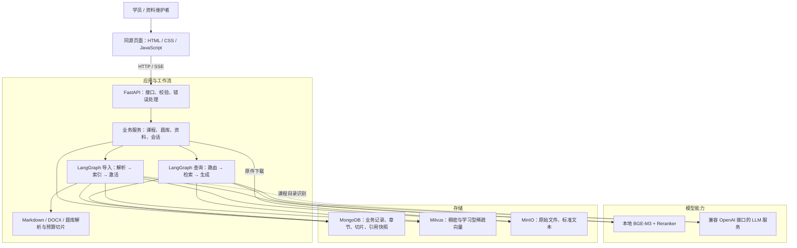
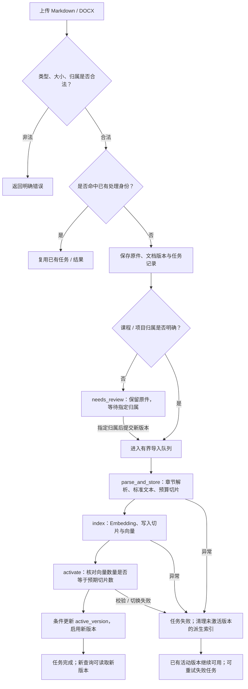
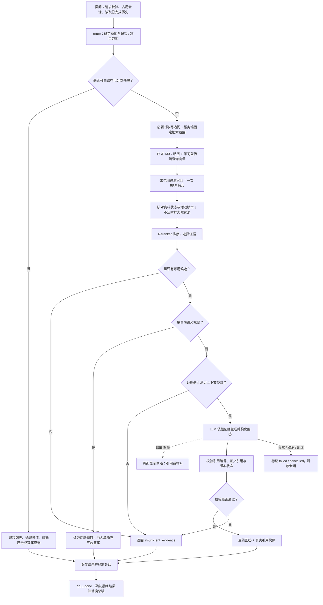

# 知成：项目讲解与演示

> 更新：当前多格式上传与 MinerU 配置见 [README](../README.md#多格式解析与-mineru)。本文的 Markdown 专用、图片不识别及旧大小限制描述为早期版本行为。

适用版本：0.1.0；核对日期：2026-10-19。

本文用于项目介绍、答辩或面试，建议讲解 12～15 分钟，评测命令与详细表格用于备查。主线是：**解决什么问题 → 为什么这样设计 → 怎么证明有效 → 个人具体贡献**。实现描述以当前源码为准，效果验证与个人职责分别说明，避免把设计目标讲成已经取得的结果。

## 1. 开场：先讲用户遇到的问题（约 1 分钟）

> 在 IT 职业培训中，学员遇到一个问题，往往需要在课程讲义、项目资料和题库之间来回查找。通用大模型可以解释知识，但它的回答是否符合当前课程、依据是课程里的哪段资料，学员很难核对。
>
> 知成是一个围绕课程资料工作的知识库与 AI 助教。它把资料整理成可检索的章节，按课程回答问题，展示引用原文，并提供相关练习。资料找不到依据时，系统有明确的“资料不足”返回路径。
>
> 接下来用一个具体问题说明：为什么 Python 函数用空列表做默认参数，多次调用后会共享内容？从讲义上传到回答、核对原文、再做一道练习，走完整个链路。

| 用户问题 | 项目提供的能力 | 观察结果 |
| --- | --- | --- |
| 资料分散，按文件名找不到知识点 | 按课程、章节整理资料，检索相关片段 | 能否定位“函数 → 可变默认参数” |
| 回答听起来合理，却不知道根据什么 | 回答附带版本、章节、原文位置与片段 | 引用能否回到真实资料 |
| 讲义更新后可能继续引用旧内容 | 新版本建成后才切换活动版本 | 新问题是否使用当前版本 |
| 看懂解释后缺少练习入口 | 导入结构化题库，题目与答案分开读取 | 用户是否能先做题，再主动查看解析 |

这里的目标是缩短“找到资料、理解问题、核对依据、巩固练习”的路径。是否实际节省学习时间，还需要用户任务实验验证。

## 2. 用一个例子贯穿（约 2 分钟）

### 2.1 准备一份可复现讲义

将下面内容另存为 `output/demo/python_functions.md`，导入时选择课程讲义，归入课程 `python_demo`。该文件是演示输入，需要在演示前自行保存；本文不会自动导入业务数据。

~~~~markdown
# Python 基础

## 函数

函数的参数可以设置默认值。理解默认值何时创建，是理解多次调用行为的关键。

### 可变默认参数

默认参数在函数定义时求值，而不是每次调用时重新求值。如果默认值是列表等可变对象，省略该参数的多次调用会复用同一个对象。下面第一次调用返回 ["A"]，第二次调用返回 ["A", "B"]，因为两次调用修改了同一个默认列表。

```python
def append_item(item, items=[]):
    items.append(item)
    return items

print(append_item("A"))
print(append_item("B"))
```

如果希望每次省略参数时都创建新列表，可以使用 None 作为默认值，在函数体内创建列表。这样两次调用分别返回 ["A"] 和 ["B"]。

```python
def append_item(item, items=None):
    if items is None:
        items = []
    items.append(item)
    return items
```
~~~~

### 2.2 沿同一个问题解释系统行为

1. **导入**：创建 `python_demo` 课程，上传这份讲义，观察任务进度。
2. **解析**：识别出 `Python 基础 / 函数 / 可变默认参数`，保留章节关系与原文行号。
3. **建索引**：章节内按实际 Embedding tokenizer 预算切片，生成稠密与学习型稀疏向量；索引核对成功后启用版本。
4. **提问**：选择该课程，问“为什么 Python 函数用空列表做默认参数，多次调用会共享内容？怎么修改？”
5. **回答**：检索课程内的活动资料，经重排后将相关原文交给 LLM；页面先展示待核对草稿，再显示最终回答和引用。
6. **核对**：展开引用，检查文件名、章节路径、Markdown 行号和原文片段，必要时下载原件。
7. **追问**：问“上面改成 None 的写法为什么可以？”系统可结合历史把追问改写成独立问题，再检索；历史回答本身不作为资料证据。
8. **练习**：将已有的 [Python 题库示例](../tests/sample_data/python_questions.md) 导入同一课程，查找 `python_basics_bank_q003`，先看题，再主动查看答案与解析。

预期回答要点：默认参数在定义时求值；可变对象被重复调用复用；用 `None` 并在函数内部创建新列表。**这些是人工核对要点，不是本次真实模型已经通过的评测结果。**

## 3. 一张项目架构图（约 2 分钟）



讲图时围绕职责说明：

- **FastAPI 与页面**负责上传、查询、流式展示和资料管理；前端没有额外构建步骤。
- **LangGraph**把导入和问答拆成明确节点，方便处理状态与失败分支；当前工作流是固定、受控的。
- **MongoDB**保存业务事实和活动版本指针；**Milvus**负责向量候选检索；**MinIO**保存原件与标准文本，三者承担不同读写职责。
- **本地模型**负责 Embedding 和重排，**LLM**负责证据回答、追问改写及课程目录识别。若 LLM 配置为外部服务，证据片段会随请求发送给该服务，不能把系统称为完全离线。

当前取舍：使用多种存储便于分工，但增加部署和一致性处理成本。应用固定为单个 Uvicorn worker，通过生命周期统一创建与释放依赖。

代码入口：[应用生命周期](../app.py)、[运行时协调](../services/runtime.py)、[部署配置](../deploy/compose.yml)。

## 4. 两个核心流程图（约 3 分钟）

### 4.1 流程一：资料如何变成可用知识

下图以讲义和项目资料为主。课程目录走 LLM 识别与结构校验分支，题库走专门的 Markdown 解析分支。



这个流程主要回答三件事：

1. **重复上传怎么办？** 按来源、归属、文件内容与处理配置识别重复任务，避免把同一次输入反复建索引；同名但内容不同的独立上传不会直接覆盖旧文档。
2. **更新失败怎么办？** 新版本完整性核对成功后才切换活动版本指针，构建失败时继续使用原活动版本。这里没有 MongoDB、Milvus、MinIO 之间的跨库事务。
3. **删除后还会被检索吗？** 删除先撤销资料的检索资格，再清理派生数据和原件；历史回答保留引用快照，并显示原件是否还可访问。

代码入口：[导入服务](../services/imports.py)、[导入图](../processor/import_processor/main_graph.py)、[章节模型](../schemas/document.py)。

### 4.2 流程二：问题如何变成可核对的回答



图中 `done` 是流式接口的终止事件；普通问答接口直接返回最终结果。异常或断连不把草稿保存成完整回答。

默认参数与实际行为：

| 环节 | 当前行为 | 设计目的与限制 |
| --- | --- | --- |
| 检索范围 | 课程 / 项目 / 资料类型等过滤先于 ANN 检索 | 减少跨课程干扰；这是业务范围控制，尚不是用户权限隔离 |
| 召回 | 默认取 20 条；活动版本候选不足 5 条时，再请求 60 条 | 降低旧版本或构建中版本占位的影响；仍是有上限的补召回 |
| 融合与重排 | Milvus 内 RRF 融合一次，最多 30 条候选参与重排，默认保留 5 条 | 融合两路排序后再判断问题与片段的相关程度；增加推理成本 |
| 上下文 | 可追加最多 2 段较短的直接父章节正文；默认证据预算 4000 token | 补充背景；使用 Embedding tokenizer 估算，不保证等于 LLM 的实际总 token 数 |
| 引用检查 | 正文编号与 `citation_ids` 一致，且均来自已提供证据；提交前再次核对活动版本 | 能拦截不存在的引用或失效版本；不能自动证明每句话都被原文支持 |

代码入口：[查询服务](../services/query.py)、[查询图](../processor/query_processor/main_graph.py)、[向量检索](../utils/clients/vector_store.py)、[SSE 接口](../api/query_service.py)。

## 5. 核心设计点：为什么这样做（约 2 分钟）

| 设计点 | 要解决的问题 | 当前实现与取舍 | 可检查的证据 |
| --- | --- | --- | --- |
| 章节解析与切片分开 | 固定长度直接切割容易丢失章节上下文 | CommonMark token 识别顶层标题，保留父子关系和源位置；再按 tokenizer 预算切片。长代码或长表格仍可能被拆开 | `utils/parsers/markdown.py`、`utils/chunking/token_budget.py`；Setext、同名标题、代码围栏和预算边界测试 |
| 原文与检索文本分开 | 为检索补上下文时，容易把补写内容误当原文 | `text` 保留原文子串；`embedding_text` 增加文件、课程和章节信息，必要时补代码围栏或表头；补充内容占用预算 | 切片器与 `test_chunking_education.py` |
| 稠密 + 学习型稀疏 + 重排 | 技术问题既有语义表达，也有函数名、术语等精确线索 | BGE-M3 两路召回，RRF 融合，Reranker 排序；稀疏向量不是 BM25，效果增益需要实测 | `utils/clients/vector_store.py`、`scripts/benchmark_retrieval.py` |
| 活动版本作为可见性依据 | 更新过程中混入半成品，失败后资料不可用 | 构建新版本、核对完整性、条件切换指针；检索及结构化查询都核对活动版本 | `services/imports.py`、`services/catalog.py`、版本更新回归测试 |
| 受控路由与题答分离 | 课程列表、精确题号等请求需要确定结果；练习不应提前暴露答案 | 能精确查询的分支直接读取结构化记录，练习响应采用字段白名单，主动查看解析时才返回答案 | `services/query.py`、`services/catalog.py`、题库回归测试 |
| 草稿与最终回答分开 | 流式内容展示很快，但引用可能要等生成结束才能核对 | SSE 增量带 `provisional=true`，`done` 用核对后的结果替换草稿；校验失败显示资料不足 | `api/query_service.py`、`page/app.js`、流式草稿替换测试 |

补充两项工程取舍：

- **并发有边界**：导入是有界队列与单消费者，本地模型使用线程池和信号量；同一会话同时提问返回 409。这样适配当前单机资源，但限制吞吐量。
- **分数不冒充把握程度**：重排阈值默认是 0，主要用于排序，没有经过校准的分数不作为“答案正确率”。无证据、模型声明不支持或引用校验失败时，有明确的资料不足路径。

## 6. 演示和验证点：怎么证明有效（约 3 分钟）

### 6.1 现场演示顺序

按 [README](../README.md) 配置并启动基础服务、应用、本地模型与 LLM 后，再执行以下演示。推荐预先导入资料，现场展示任务结果，再做一次小文件上传。

| 步骤 | 操作 | 重点观察 | 能支持的结论 |
| --- | --- | --- | --- |
| 1 | 查看 `/health/ready` 与 `/api/v1/capabilities` | 存储、模型、查询能力分别是否就绪 | 运行依赖已初始化；LLM 连通性仍需实际提问确认 |
| 2 | 创建 `python_demo`，导入示例讲义 | 任务完成；目录有层级和原文位置 | 资料进入了可查询链路 |
| 3 | 重复上传同一文件与归属 | 接口结果 `reused=true` | 对相同处理身份的导入具备幂等复用 |
| 4 | 提问“可变默认参数为什么共享内容，怎么改？” | 草稿、最终回答、引用、原件下载 | 正向场景能完成，并可由人工核对依据 |
| 5 | 追问“上面改成 None 的写法为什么可以？” | 回答是否仍围绕该章节 | 多轮追问可继续；单例成功不代表所有追问都正确 |
| 6 | 导入题库，查找 `python_basics_bank_q003` | 初次不展示答案，点击后才读取解析 | 题目展示与答案读取分开 |
| 7 | 切换到另建且无讲义的课程，重新提问 | 返回资料不足，没有 Python 讲义引用 | 课程范围过滤生效 |
| 8 | 上传新版讲义，再删除这份演示文档 | 新查询使用活动版本；删除后不再召回；旧会话保留引用片段 | 版本与删除语义有效 |

更新失败、伪造引用和断连等场景使用隔离测试展示，便于稳定复现。演示“回答正确”时应逐项对照第 2 节的知识点和引用原文。

### 6.2 自动回归：证明机制按预期工作

在项目根目录运行：

```powershell
uv run python -m pytest -q
```

若受限环境无法创建系统临时目录，可为 `--basetemp` 指定项目内的**全新专用目录**。pytest 会清空指定目录，不能复用存放业务数据的路径：

```powershell
New-Item -ItemType Directory -Path output -Force | Out-Null
$testRunPath = Join-Path (Get-Location).Path ('output/pytest-docs-' + [guid]::NewGuid().ToString('N'))
uv run python -m pytest -q --basetemp $testRunPath
```

本次源码核查的实际运行结果见本节末尾。测试使用 `mongomock` 和模型、对象存储、向量存储替身，**它们验证程序行为，不提供真实模型问答质量或真实存储兼容性的证明**。

| 风险 | 已有测试文件 / 场景 | 关键断言 |
| --- | --- | --- |
| Markdown 误识别标题、切片超预算 | `tests/component_tests/test_parsers.py`、`test_chunking_education.py` | Setext 与重复标题可保留；代码、引用和列表中的伪标题不被误识别；长代码和表格不超预算 |
| 更新失败破坏旧资料 | `tests/api_workflow_tests/test_workflows.py` | Embedding 失败时旧活动版本仍可用；重试后才切换版本 |
| 引用编号伪造、错误草稿入历史 | `test_workflows.py`、`test_feedback.py` | `[99]` 等未提供的引用被拒绝；最终结果替换草稿，历史保存核对后的结果 |
| 断连后会话一直被占用 | `tests/api_workflow_tests/test_cancellation.py` | 助手消息转为 cancelled，会话占用释放 |
| 练习提前泄露答案 | `tests/api_workflow_tests/test_workflows.py` | 练习响应无答案和解析，主动读取答案才返回 |
| 删除后继续引用或丢失历史依据 | `tests/api_workflow_tests/test_workflows.py` | 删除后新查询资料不足、下载返回 410，旧历史引用快照仍存在 |
| 目录模型识别失真 | `test_catalog_recognition.py`、`test_catalog_import.py` | 不可核对的识别结果被拒绝；待确认结果不替换原活动目录 |

### 6.3 真实效果：用人工标注和对照评测回答

当前源码提供评测脚本。本次未执行真实模型评测，也没有可据此宣称的“准确率提升 X%”或耗时改善结论。

建议准备一组人工审核问题，覆盖直接问法、同义问法、代码术语和资料不足；逐条标注课程、应命中的章节、答案要点与是否应拒答。当前回答评测脚本每条用例新建会话并只发送一次问题，只覆盖单轮；多轮追问需另行人工或编写脚本验证。生成候选题后仍需人工检查：

```powershell
uv run python -m scripts.build_eval_cases output/demo/python_functions.md --course python_demo --output output/demo/eval-candidates.jsonl
```

脚本只为正文不少于 80 字符的有标题章节生成候选，`reviewed` 初始为 `false`。人工审核问题与标签后，将审核过的用例保存为 `output/demo/eval-reviewed.jsonl`，再运行：

```powershell
uv run --extra local-models python -m scripts.benchmark_retrieval output/demo/eval-reviewed.jsonl --output output/demo/retrieval-benchmark.json
uv run python -m scripts.evaluate output/demo/eval-reviewed.jsonl --output output/demo/eval-report.json
```

检索基准会单独加载一套本地模型，需为其预留内存 / 显存。数据、索引和配置准备好后，可先停止应用来运行检索基准；回答评测则需要应用在线。

| 指标 | 当前脚本的实际口径 | 能证明什么 / 不能证明什么 |
| --- | --- | --- |
| 章节 Recall@5 | 前 5 个切片覆盖的人工标注章节数 ÷ 应命中章节总数；同章节多个切片不重复计分 | 衡量前 5 条候选对目标章节的覆盖；不是答案正确率，也不是按不同章节去重后另取 5 个章节 |
| `source_hit_ratio` | 最终引用覆盖的预期来源数 ÷ 预期来源总数，按文件名和完整标题路径匹配 | 衡量最终引用是否命中目标来源；不是检索 Recall@5 |
| `expected_text_match` | 是否包含所有人工填写的预期字符串 | 是字面检查，可能误判等价表述或错误上下文，不能代替人工判分 |
| `insufficiency_match` | 对 `expect_insufficient=true` 的用例，结果是否为 `insufficient_evidence` | 只检查标记为资料不足的用例，没有自动形成完整的拒答混淆矩阵 |
| 首段与总耗时 | 首个 `token` 展示事件耗时、整次请求耗时 | 首段是草稿展示时间；脚本首段计时起点晚于发起请求，不等于严格的端到端首 token 时间 |
| 人工答案正确率、引用支持率 | 人工逐题审核答案事实与引用支撑关系 | 当前回答评测脚本对应字段保留为 `null`，需另行记录人工结果 |

对照时可以先看脚本中的 dense、hybrid、rerank 三种结果，但必须说明：**现有基准分别取 dense 20 条、hybrid 30 条候选后比较，重排使用 hybrid 候选；它不能单独证明收益完全来自某一种算法。** 若要报告严格消融结果，应统一候选预算、过滤策略与数据版本，并另行记录每个阶段耗时。当前基准的 `seconds` 包含编码和多种策略的合计执行时间。

基准固定查询课程讲义，也没有复现线上补召回、阈值过滤、父章节补充、上下文预算和最终引用检查，离线章节命中不能直接当作线上回答效果。当前工作区未提供正式人工审核评测集或真实效果报告，需要自行准备并保留数据版本。

真实环境的依赖与本地模型检查可使用：

```powershell
uv run python -m scripts.doctor
uv run --extra local-models python -m scripts.check_models
```

`doctor` 检查基础服务；`check_models` 实际运行 Embedding 和重排，并输出 `output/model-validation.json`。它们仍不能替代 LLM 实际调用和课程问答评测。

### 6.4 本次核查记录

- 核查对象：当前工作区的 README、架构说明、业务服务、工作流、解析与切片、存储适配、页面、测试及评测脚本。
- 自动测试：首次运行为 77 passed、3 setup errors，3 项错误发生在 pytest 临时目录创建阶段。重跑过程中原项目从 `D:\code_workspace\ZhiJie` 移至 `D:\code_workspace\ZhiChengApp`，原路径失效又导致测试失败；本次未取得全量通过结果，需在新目录重新验证。
- 未执行：真实 MongoDB / Milvus / MinIO 联调、GPU 模型推理、LLM 请求、浏览器现场演示及人工质量评测。

## 7. 个人贡献：把“我做了什么”落到实现与证据（约 1 分钟）

以下是基于当前实现整理的**职责核对表和第一人称讲述模板**。当前目录没有可核对的 Git 提交历史，无法仅凭源码判定作者或独立完成范围；实际介绍时只保留本人确实负责的项目，团队协作部分明确分工。

| 贡献方向 | 具体工作与可讲述的决策 | 实现证据 |
| --- | --- | --- |
| 数据与模块设计 | 定义文档、版本、章节、切片、任务、会话与引用关系，划分 API、服务、工作流和存储职责 | `schemas/`、`repositories/mongo.py`、`services/runtime.py` |
| 资料入库链路 | 实现 Markdown / DOCX 解析、结构化题库导入、预算切片，保留源位置；补充幂等、重试、活动版本切换与删除流程 | `utils/parsers/`、`utils/chunking/`、`services/imports.py` |
| 课程问答链路 | 实现范围过滤、双路召回、RRF、重排、证据生成与引用编号校验 | `services/query.py`、`utils/clients/vector_store.py` |
| 用户操作闭环 | 实现资料管理、SSE 草稿与最终结果、引用展开和下载、题目与解析分离、会话保存和取消 | `page/`、`api/`、`services/catalog.py` |
| 工程验证与交付 | 组织隔离测试、失败注入、健康检查、Compose 与本地模型检查、候选题生成与评测脚本 | `tests/`、`deploy/compose.yml`、`scripts/` |

可按实际职责使用的讲述模板：

> 我主要负责资料入库到引用回答这条链路。具体工作是把文档解析为带层级和来源位置的章节，再按模型预算建索引；问答时约束课程范围，组合召回和重排，并在输出前核对引用。
>
> 我重点处理了两个容易被演示掩盖的问题：更新失败时旧资料是否仍能用，以及流式显示的草稿能否被误当成最终答案。我通过活动版本切换、草稿与最终结果分离，以及对应的失败场景测试，把这两个行为明确下来。
>
> 检索和生成使用已有模型，我负责的是模型接入、业务链路和验证方法。真实课程上的检索收益与回答质量还需要人工标注评测，当前没有足够证据给出提升百分比。

讲贡献时优先选两项最熟悉、确实由本人完成的工作，说明“遇到什么失败 → 做了什么决策 → 哪个测试或演示能复现结果”，再按追问展开代码。

## 8. 当前边界（约 1 分钟）

| 方面 | 当前边界 | 对使用和后续工作的影响 |
| --- | --- | --- |
| 用户与权限 | 单机、单用户；尚无登录、角色权限、按用户隔离 | 适合本机验证。已有 [登录与用户权限设计](登录与用户权限设计-v0.1.md) 是设计稿，不能算已实现功能 |
| 并发与恢复 | 固定一个 Uvicorn worker；队列与会话占用在进程内，任务记录持久化 | 不能直接增加 worker 当作扩容；重启后 processing 导入标记 interrupted，需从原件手动重试；queued 任务会重新获取；processing 消息标记 cancelled |
| 一致性 | 多存储无跨库事务，以活动版本检查、失败清理和补偿维持可见性 | 不宣称强事务或零故障；扩大部署前需进一步验证故障恢复 |
| 文档支持 | 讲义 / 项目资料支持 Markdown、DOCX；目录和结构化题库使用 Markdown；不支持 PDF / OCR | DOCX 使用段落 / 表格块定位，不提供原始页码；不提取图片、页眉页脚、文本框和嵌套表格 |
| 检索与拒答 | 候选数有上限；重排分数未校准；意图识别与选课采用受控规则 | 可能漏召回、误路由或需要澄清；不能保证所有无依据问题都正确拒答 |
| 回答可信度 | 引用自动检查覆盖编号、来源与版本状态 | 语义是否被原文支持仍需人工审核；有引用不等于答案必然正确 |
| 题库 | 依赖规定的结构化 Markdown 格式；导入记录仍标记未审核 | 能展示题目与标准解析，未审核标记不等于已完成人工内容审核，也没有自动判分与个性化掌握度模型 |
| 模型与网络 | 本地 Embedding / 重排依赖模型文件和设备；LLM 依赖配置的兼容服务；无联网知识检索或自主工具规划 | 本地模型和外部服务分别验证；课程问答证据来自已导入资料 |
| 效果证据 | 有隔离回归和评测工具，本次未跑真实模型与用户实验 | 可以说明机制与测试结果，暂不能承诺生产质量、学习提效或具体准确率提升 |

建议收尾：

> 当前版本把资料导入、课程范围问答、引用核对和练习串成了一个可演示的闭环，也覆盖了更新失败、伪造引用和流式中断等回归场景。下一步需要在真实课程资料上完成检索对照与人工答案审核，再根据使用场景推进权限和运行能力。
